# SI-PMS — SI 프로젝트 인력·평가 관리 시스템

> Database Design Team Project · Fall 2026
> 100명 규모 SI 업체의 **프로젝트 – 투입 인력 – 직무 – 기간** 관리와 프로젝트 종료 시 **고객 / PM / 동료 평가**, 그리고 조별 특화 시나리오로 **고객사 변경요청 승인**과 **평가 기반 교육 이수 관리**를 지원하는 사내 웹 시스템

| 상태 | 내용 |
|---|---|
| ✅ DB | MySQL 8.0 · 테이블 28 · 뷰 6 · 트리거 23 · 프로시저 5 · 외래키 43 |
| ✅ 데이터 | 직원 100 (개발자 70 · 지원직 30) · 프로젝트 60 (과거 월평균 동시 수행 10.1개) · 투입 454 · 평가 1,594 · 변경요청 8 · 교육계획 15 |
| ✅ 웹 앱 | Flask · 39개 라우트, 4개 역할(경영진·PM·개발자·교육 담당자)로 전 화면 점검 통과 |
| ✅ 규칙 검증 | 비즈니스 규칙 BR-01~30, DB 수준 거부 30건 확인 (`db/demo/constraint_tests.sql`) |
| ✅ 성능 | 투입 100만 건 실험, 커버링 인덱스로 최대 4.0배 개선 |
| ✅ 문서 | 요구사항 정의서(엑셀 양식) · ERD 이미지 · 테이블 정의서 · CRUD · 데모 시나리오 · 성능 실험 · 설계 결정 |

**목차** · [5분 시작하기](#5분-시작하기) · [구조](#구조) · [설계 핵심](#설계-핵심) · [조별 특화 시나리오](#조별-특화-시나리오) · [비즈니스 규칙](#비즈니스-규칙) · [데모 시나리오](#데모-시나리오) · [성능 실험](#성능-실험) · [산출물과 일정](#산출물과-일정) · [화면](#화면) · [남은 일](#남은-일)

---

## 5분 시작하기

필요한 것: **Docker Desktop**, **Python 3.10+**

```bash
git clone https://github.com/moovingGun/database-teamproject.git
cd database-teamproject

# 1) DB 기동 — 최초 1회 db/init/*.sql 이 자동 실행됨 (스키마 → 트리거/뷰 → 테스트 데이터)
docker compose up -d

# 2) 웹 앱
python3 -m venv .venv && .venv/bin/pip install -r requirements.txt
.venv/bin/python run.py          # → http://127.0.0.1:5001
```

**데모 계정** (비밀번호 공통 `pass1234`)

| 아이디 | 역할 | 볼 수 있는 것 |
|---|---|---|
| `ceo`, `exec01` | 경영진 | 직원 검색, 투입 관리, 시점별 현황, 평가·인센티브, **변경요청 승인**, **교육 현황** |
| `pm01` | 특급 개발자, PM | PM 평가, 고객 평가 의뢰·보고, **변경요청 접수·검토안·고객 동의·반영** |
| `dev01` | 고급 개발자 | 내 정보·보유 기술, 동료 평가, **내 교육 신청** |
| `edu01` | 경영관리 · 교육 담당자 | **역량개선계획 수립, 수료 기록** |

**자주 쓰는 명령**

| 명령 | 용도 |
|---|---|
| `./db/reset.sh` | DB 를 초기 시드 상태로 재적재 (컨테이너 유지) |
| `./scripts/smoke_test.sh` | 4개 역할로 전 화면 호출 점검 (데이터 변경 없음) |
| `./scripts/e2e_test.sh` | 가입·평가·투입·변경요청·교육 쓰기 흐름 점검 (끝나면 `./db/reset.sh`) |
| `docker exec -i si_pms_db mysql -uroot -proot1234 --default-character-set=utf8mb4 --force si_pms < db/demo/constraint_tests.sql` | 규칙 위반 거부 증빙 (ROLLBACK, 데이터 변경 없음) |
| `.venv/bin/python scripts/gen_erd.py` | ERD 이미지 재생성 (`brew install graphviz` 필요) |
| `.venv/bin/python scripts/gen_table_spec.py` | 테이블 정의서를 실제 DB 에서 재생성 |
| `.venv/bin/python scripts/capture_screenshots.py` | 기능 화면 스크린샷 재촬영 (Chrome 필요) |
| `.venv/bin/python scripts/gen_seed.py` | 시드 SQL 재생성 (고정 seed → 항상 같은 데이터) |

> Docker 초기 적재는 **볼륨이 비어 있을 때 한 번만** 실행됩니다. 스키마를 고쳤다면 `./db/reset.sh` 를 돌리세요.

---

## 구조

무결성 규칙은 **DB(트리거·CHECK·FK)** 가, 화면 흐름과 권한은 **앱** 이 맡습니다. UI 를 거치지 않는 SQL 적재에도 같은 규칙이 적용됩니다.

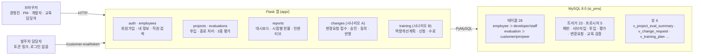

```
db/init/      00_privileges.sql   01_schema.sql (DDL)   02_logic.sql (프로시저·트리거·뷰)   03_seed.sql (테스트 데이터)
db/demo/      demo_scenarios.sql (S1~S8)   constraint_tests.sql (규칙 검증)
db/perf/      perf_indexes.sql (성능 인덱스 비교)
app/          auth · employees · projects · evaluations · reports · changes · training 블루프린트 + templates
scripts/      시드·정의서·ERD·스크린샷·엑셀 생성기, smoke_test.sh · e2e_test.sh · perf_benchmark.py
docs/         산출물 문서, erd/ (ERD 이미지), screenshots/ (기능 화면)
```

---

## 설계 핵심

| 가이드라인 | 반영 |
|---|---|
| 직원 · 프로젝트 평가는 **슈퍼타입-서브타입** | `employee` → `developer` / `staff`, `evaluation` → `customer_eval` / `pm_eval` / `peer_eval`. 서브타입 PK 가 슈퍼타입 PK 를 공유하고, 판별자와 서브타입이 어긋나거나 서브타입이 겹치면 트리거가 거부 (BR-10, BR-30) |
| **발주처는 별도 엔티티** | `client` + `client_contact` (1:N). 고객 평가와 변경요청의 요청·동의 담당자가 FK 로 참조 |
| **M:N 지양** | 교차 엔티티 `employee_skill`, `project_skill`, `assignment`, `training_enrollment` 로 해소 → ERD 에 M:N 없음 |
| **1:N 에서 Total:Total 지양** | 모든 1:N 의 1측을 Partial 로 설계 (근거: [`docs/02_ERD.md`](docs/02_ERD.md) §3). 시드에 관계마다 '자식 없는 부모' 예시를 넣어 시연 가능 |
| **추가 비즈니스 로직 고도화** | 기본 업무 규칙 BR-01~15, BR-30 + 조별 특화 시나리오 A (BR-16~23), B (BR-24~29) |

### ERD (IE 표기, 실제 DB 에서 자동 생성)

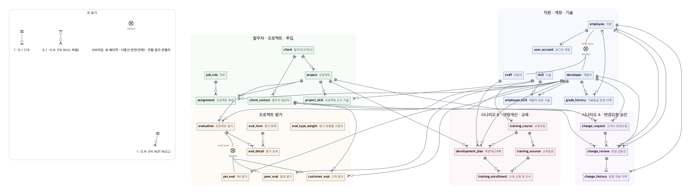

영역별 상세(속성 포함): [직원·계정·기술](docs/erd/01_hr.png) · [발주처·프로젝트·투입](docs/erd/02_prj.png) · [프로젝트 평가](docs/erd/03_eval.png) · [시나리오 A 변경요청](docs/erd/04_chg.png) · [시나리오 B 교육](docs/erd/05_edu.png). 관계선 양 끝은 `┼┼` 정확히 1, `┼○` 0 또는 1, `○<` 0 이상입니다.

---

## 조별 특화 시나리오

팀원이 제안한 두 시나리오를 설계·구현했습니다. 원 제안에서 바꾼 부분과 이유는 [`docs/07_핵심설계결정.md`](docs/07_핵심설계결정.md) D-11~D-13 에 있습니다.

### A. 고객사 변경요청 및 승인 관리

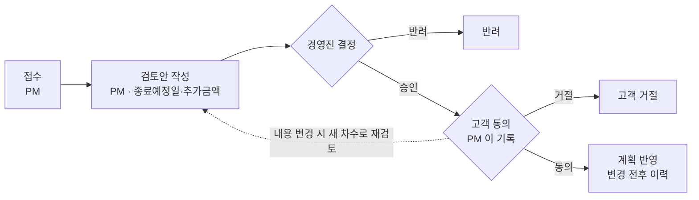

- 테이블 3개: `change_request` ─< `change_review`(차수) ─ `change_history`. 팀 초안 5개 중 승인·고객동의를 검토안에 합쳤습니다(1:1 관계라서).
- 프로젝트의 **종료예정일**(`end_date`)과 **실제 종료일**(`actual_end_date`)을 분리했습니다. 변경요청은 종료예정일만 바꾸고, 투입 기간은 자동으로 늘리지 않습니다.
- 화면: 프로젝트 상세의 변경요청 섹션, 변경요청 상세(`/changes/<id>`), 경영진 변경요청 현황(`/reports/changes`, 데모 S7).

### B. 프로젝트 평가 기반 역량 개선 및 교육 이수 관리

- 테이블 4개: `training_course` ─< `training_session`, `development_plan`(직원 × 추천 과정) ─< `training_enrollment` >─ `training_session`. 교육 담당자는 `staff.is_training_manager` 로 지정합니다.
- 팀 초안 대비 신청 테이블의 직원번호를 뺐습니다(계획에서 결정되는 이행 종속). 계획의 미신청·신청·수료 상태는 신청 이력에서 계산합니다.
- 점수만으로 자동 배정하지 않고 담당자가 평가 의견·보유 기술을 보고 계획을 세웁니다. 수료는 기술등급을 바꾸지 않습니다.
- 화면: 교육 관리(`/training`, 담당자), 내 교육(`/me/training`), 교육 이수 현황(`/reports/training`, 데모 S8).

---

## 비즈니스 규칙

아래 명령 한 번으로 규칙이 실제로 거부되는 것을 볼 수 있습니다 (마지막에 ROLLBACK, 데이터 변경 없음).

```bash
docker exec -i si_pms_db mysql -uroot -proot1234 --default-character-set=utf8mb4 --force si_pms < db/demo/constraint_tests.sql
```

| 번호 | 규칙 | 구현 |
|---|---|---|
| BR-01~07 | 개발자만 투입, 프로젝트 기간 안, 중복 투입 금지, 투입률 합계 100% 이하, 같은 기간 PM 1명, 직무별 최소 등급 | `sp_validate_assignment` (투입 트리거) |
| BR-02 | 사번 `E+YY+NNNN`, 프로젝트번호 `P+YYYY-NNN` 자동 채번 | `trg_employee_bi`, `trg_project_bi` |
| BR-08~14 | 평가는 종료 프로젝트·참여자만, 서브타입 일치, 고객 평가자는 발주처 담당자, 의뢰는 PM, 자기평가 금지·1건 | 평가 트리거 4종 |
| BR-15 | 기술등급 변경 시 이력 자동 기록 | `trg_developer_au` |
| BR-30 | 직원 서브타입 = 판별자, 개발자·지원직 배타, 서브타입이 있으면 판별자 변경 금지 | `trg_developer_bi`, `trg_staff_bi`, `trg_employee_bu` |
| BR-16~23 | [A] 예정·진행 프로젝트만, 발주처 담당자, PM 만 접수·검토, 최신 차수만, 결정 후 수정 금지, 경영진만 승인, 승인 후 동의, 승인+동의 후 반영·중복 금지·투입보다 이른 종료 거부 | 변경요청 트리거·`sp_apply_change` |
| BR-24~29 | [B] 종료 프로젝트 참여자만 계획 대상, 교육 담당자만 수립, 추천 과정 일정만, 중복 신청·정원 초과 금지, 시작 전 신청·종료 후 수료 | 교육 트리거 |

> ⚠️ **팀 합의 필요** — 평가 가중치(고객 40 · PM 40 · 동료 20), 등급 기준(S 4.5 · A 4.0 · B 3.0), 인센티브 지급률, 직무별 최소 등급은 가정값입니다. 전체 목록은 엑셀 [`docs/01-1_요구사항정의서.xlsx`](docs/01-1_요구사항정의서.xlsx) 의 '팀 확인 필요 사항' 시트.

---

## 데모 시나리오

과제 요구는 ⌈조원 수 / 2⌉ 개 (2개 이상 테이블 조인). **8개** 를 준비했습니다. **S2 가 대표 시나리오** 이자 성능 실험 대상입니다.
SQL 전문 [`db/demo/demo_scenarios.sql`](db/demo/demo_scenarios.sql) · 해설 [`docs/05_데모시나리오.md`](docs/05_데모시나리오.md) · 실행 결과 [`docs/05_데모시나리오_실행결과.txt`](docs/05_데모시나리오_실행결과.txt)

| # | 시나리오 | 조인 | 화면 |
|---|---|---|---|
| S1 | 경영진 대시보드 — 진행 중 프로젝트별 투입 인원·FTE·PM·직무 구성 | 5 | `/` |
| **S2 ★** | **특정 시점(예: 2025-06-01)에 누가 어느 프로젝트에 어떤 직무로 있었는가** | 6 | `/reports/staffing` |
| S3 | 개인별 경력관리 — 참여 이력 · 보유 기술 · 총 경력 | 7+3 | `/employees/<id>` |
| S4 | 프로젝트 평가 종합 — 고객/PM/동료 평균, 가중 종합점수, 등급 | 6~10 | `/reports/evaluations` |
| S5 | 인센티브 기초자료 — 연도별 개인 평균 점수 · 등급 · 지급 권고액 | 6 | `/reports/incentive` |
| S6 | 투입 후보 검색 — 기간 가용성 + 기술 숙련도 + 등급 | 5 | `/employees` 필터 |
| S7 | [A] 변경요청 처리 현황 — 최신 검토안·승인·동의·반영 전후 값 (미처리 포함) | 10 | `/reports/changes` |
| S8 | [B] 평가 결과 + 역량개선계획 + 신청·수료 현황 (미신청 포함), 과정별 수요 | 9 | `/reports/training` |

발표 데모 흐름은 [`docs/05_데모시나리오.md`](docs/05_데모시나리오.md) 마지막 절에 있습니다.

---

## 성능 실험

S2 질의를 **투입 100만 건** 에서 세 조건으로 비교했습니다 (각 5회 측정 중앙값, ms). 상세: [`docs/06_성능향상기법_실험.md`](docs/06_성능향상기법_실험.md)

| 기준일 | A. 인덱스 없음 | B. 복합 `(end_date, start_date)` | C. 커버링 인덱스 | C 개선 |
|---|---:|---:|---:|---:|
| 2026-06-01 (최근) | 160.8 | 42.9 | **40.3** | **4.0×** |
| 2020-06-01 (중간) | 178.0 | 174.6 | **78.7** | **2.3×** |
| 2012-06-01 (과거) | 184.7 | 184.8 | **129.6** | **1.4×** |

→ **C 커버링 인덱스 `idx_assignment_period` 를 스키마에 채택**

---

## 산출물과 일정

| 일정 | 보고 | 산출물 | 파일 |
|---|---|---|---|
| **10/26 (월)** | 분석 보고 10% | 요구사항 정의서 (Problem Description only, **제출 양식**) | [`docs/01-1_요구사항정의서.xlsx`](docs/01-1_요구사항정의서.xlsx) |
| | | 분석 보고서 (설명 자료, 흐름도 포함) | [`docs/01_분석보고서.md`](docs/01_분석보고서.md) |
| **11/09 (월)** | 설계 보고 50% | 요구사항 확장판 (가정 · 비즈니스 규칙 · **조별 특화 시나리오 A·B**) | [`docs/01_요구사항정의서.md`](docs/01_요구사항정의서.md) |
| | | E-R Diagram (IE 표기) | [`docs/erd/`](docs/erd/) 이미지, [`docs/02_ERD.md`](docs/02_ERD.md), [`docs/erd.dbml`](docs/erd.dbml) |
| | | 데이터베이스 정의서 | [`docs/03_테이블정의서.md`](docs/03_테이블정의서.md) (DB 에서 자동 생성) |
| | | CRUD Matrix | [`docs/04_CRUD매트릭스.md`](docs/04_CRUD매트릭스.md) |
| **11/23 (월)** | 구축 보고 20% | 생성·적재 스크립트 | [`db/init/`](db/init/) |
| | | 적재 증빙 | [`docs/05_데모시나리오_실행결과.txt`](docs/05_데모시나리오_실행결과.txt), [`docs/screenshots/`](docs/screenshots/) |
| **12/07 (월)** | 최종보고서 20% | 시스템 아키텍처 | 이 README §구조 |
| | | 데모 시나리오 (SQL) | [`docs/05_데모시나리오.md`](docs/05_데모시나리오.md) |
| | | 성능 향상 기법 및 실험 결과 | [`docs/06_성능향상기법_실험.md`](docs/06_성능향상기법_실험.md) |
| | | 핵심 설계 결정 보고서 | [`docs/07_핵심설계결정.md`](docs/07_핵심설계결정.md) |
| — | 전체 | 요구사항 준수 체크리스트 | [`docs/00_요구사항_준수_체크리스트.md`](docs/00_요구사항_준수_체크리스트.md) |

> 각 마감일 23:59 까지 LMS 제출. 지각 시 1시간마다 10점 감점, **12/07 이후 최종보고서는 받지 않음**.

### 역할 분담 제안

| 영역 | 할 일 | 기준 파일 |
|---|---|---|
| 분석·문서 | 엑셀 요구사항 정의서 확인 후 10/26 제출, 확인 사항 회의 결정 기록 | `docs/01-1_요구사항정의서.xlsx` |
| 설계·ERD | ERD 이미지 검토, Total/Partial 근거 표와 설계 결정 보완 | `docs/erd/`, `docs/02`, `docs/07` |
| DB·SQL | DDL·시드 제출 형식 정리, 규칙 검증 결과 캡처 | `db/init`, `db/demo` |
| 앱·데모 | 발표 데모 리허설 (변경요청·교육 흐름 포함) | `app/`, `docs/05` |
| 성능·실험 | 실험 재실행과 그래프, 대안 비교 서술 | `scripts/perf_benchmark.py`, `docs/06` |

---

## 화면

`scripts/capture_screenshots.py` 로 시드 데이터 상태에서 자동 촬영했습니다. 전체 목록은 [`docs/screenshots/`](docs/screenshots/).

| 경영진 대시보드 (S1) | 시점별 투입 현황 (S2) |
|---|---|
| 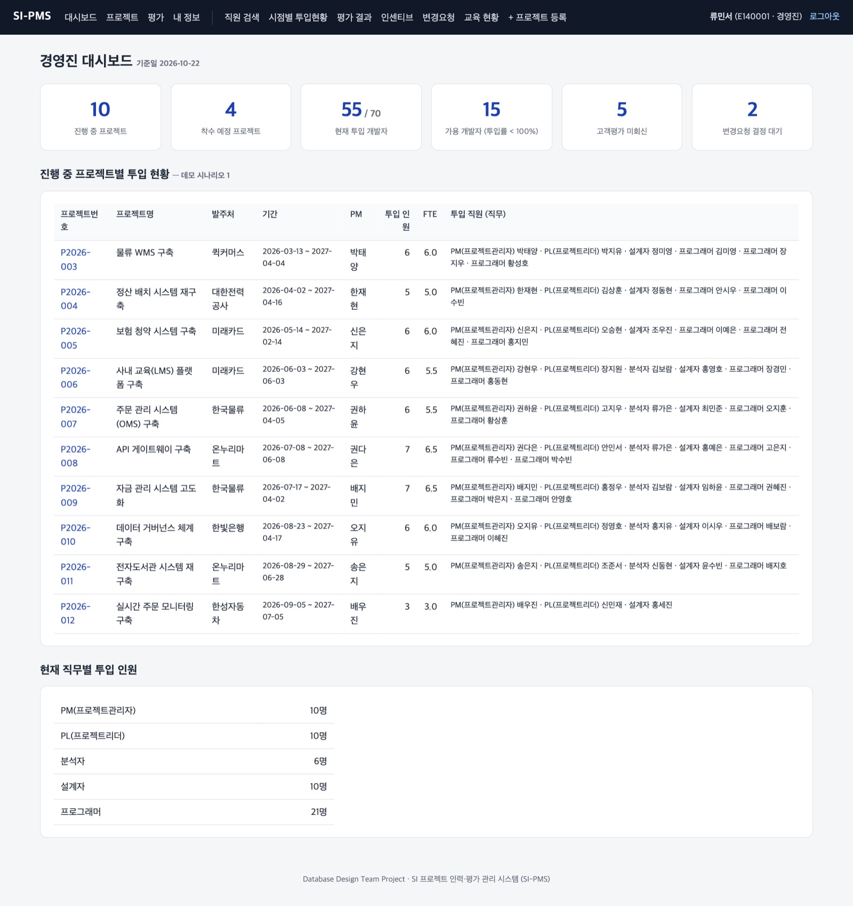 | 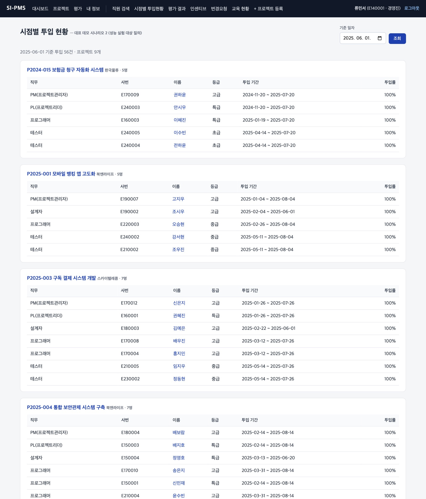 |
| **투입 규칙 거부 (BR-05)** | **회원가입 ID 중복 확인** |
| 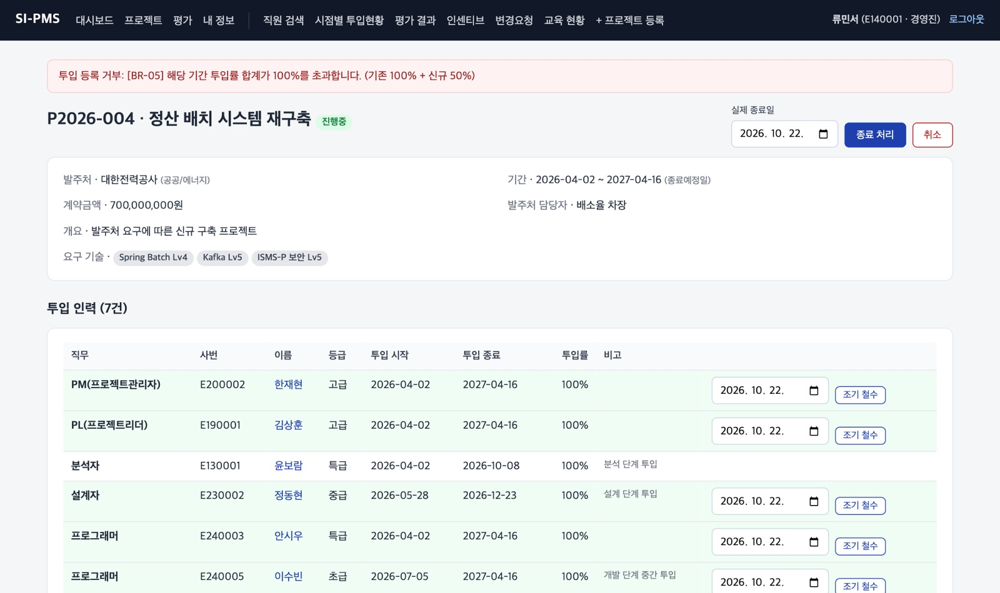 | 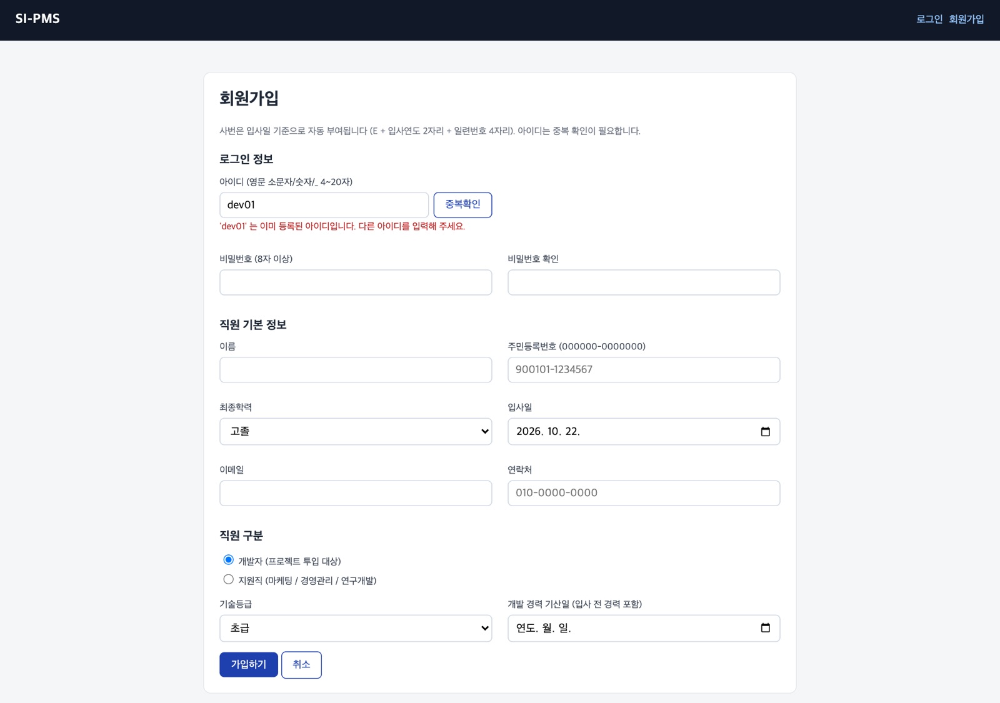 |
| **[A] 변경요청 승인 대기** | **[A] 반영 완료, 변경 전후 값** |
| 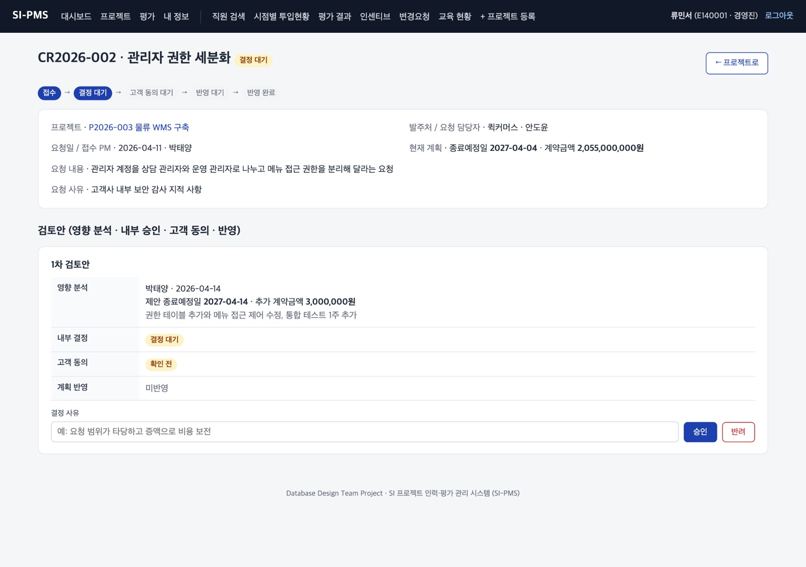 | 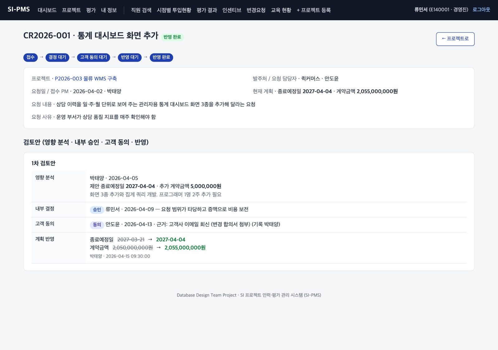 |
| **[B] 교육 관리 (담당자)** | **[B] 내 교육 (직원)** |
| 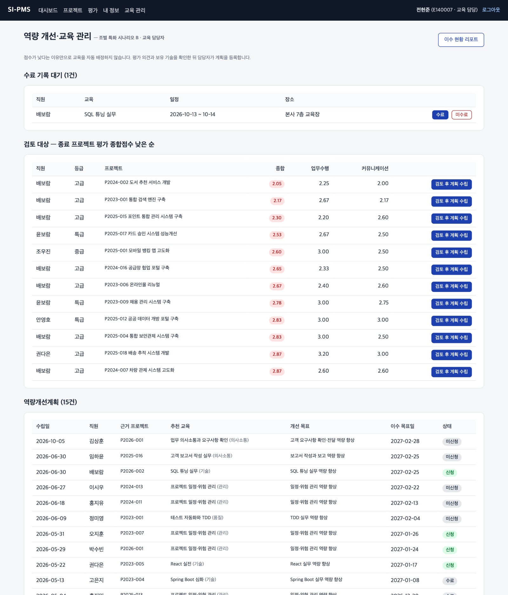 | 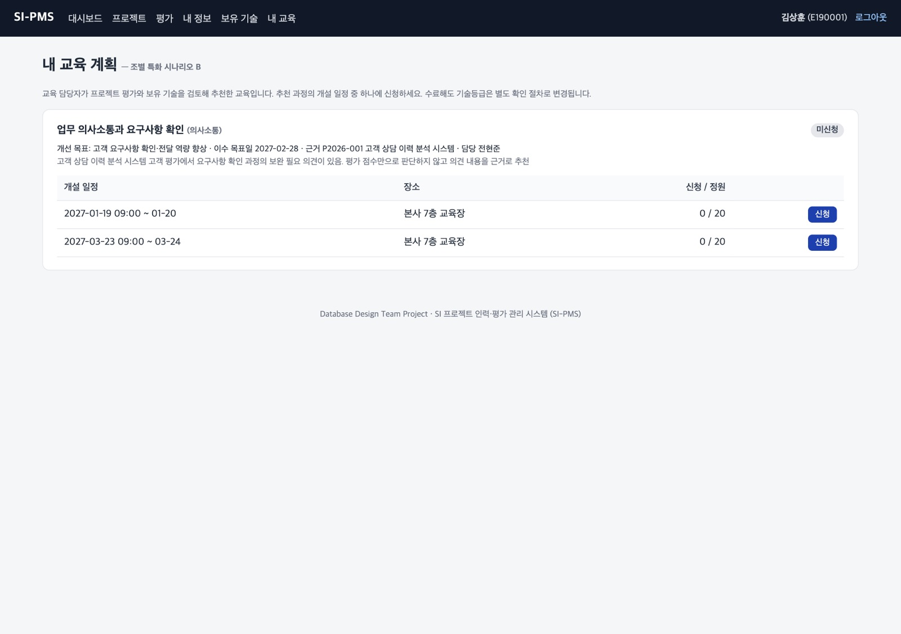 |

---

## 남은 일

- [ ] **10/26 제출** — 엑셀 요구사항 정의서의 조 번호·팀원 정보 확인 후 LMS 제출
- [ ] **가정값 합의** — 엑셀 '팀 확인 필요 사항' 20개의 결정 내용(노란 칸) 채우기
- [ ] **시나리오 선택** — 조원 수에 맞춰 데모 시나리오 선택 (S2 유지), 특화 시나리오 A·B 를 둘 다 둘지 결정
- [ ] **PM 평가의 공백** — PM 을 'PM 평가'하는 사람이 없음. 경영진 평가 추가 여부 결정
- [ ] **보고서 양식** — 11/09 이후 산출물을 수업 양식으로 옮기기

<sub>기술 스택: MySQL 8.0 (Docker) · Python 3 · Flask · PyMySQL · 서버 렌더링. 비밀번호는 PBKDF2-SHA256 해시, 주민등록번호는 화면 마스킹, 모든 쿼리는 파라미터 바인딩. 같은 내용의 HTML 버전: `docs/팀가이드.html`</sub>
