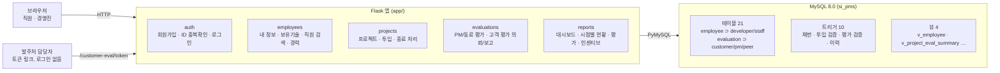
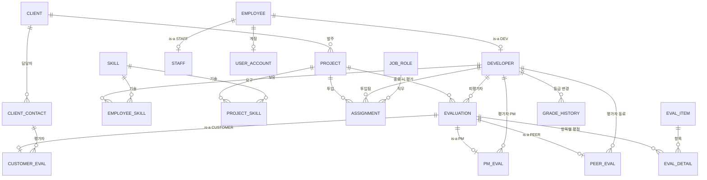
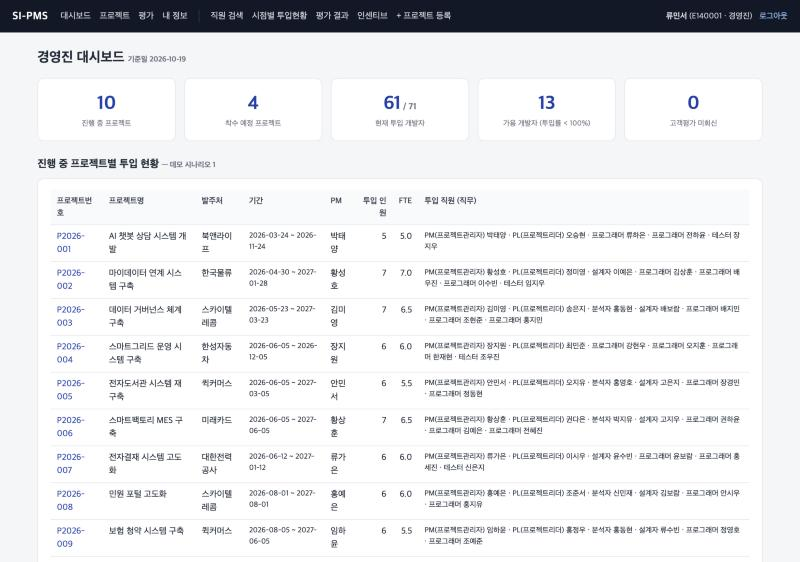
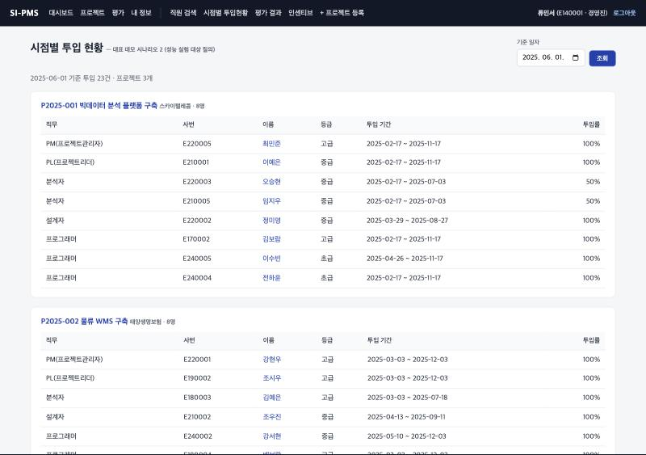
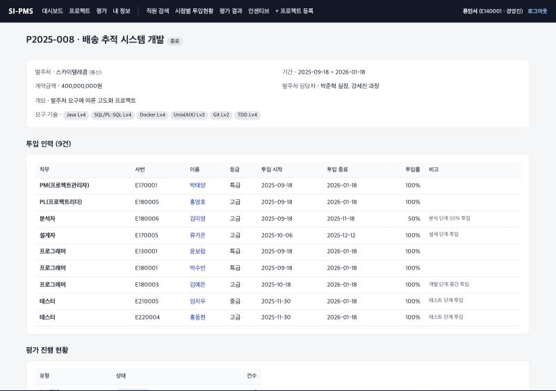

# SI-PMS — SI 프로젝트 인력·평가 관리 시스템

> Database Design Team Project · Fall 2026
> 100명 규모 SI 업체의 **프로젝트 – 투입 인력 – 직무 – 기간** 관리와, 프로젝트 종료 시 **고객 / PM / 동료 평가** 를 지원하는 사내 웹 시스템

| 상태 | 내용 |
|---|---|
| ✅ DB | MySQL 8.0 · 테이블 21 · 뷰 4 · 트리거 10 · 프로시저 2 |
| ✅ 데이터 | 직원 100 (개발자 70 · 지원직 30) · 프로젝트 28 (진행중 10) · 투입 208 · 평가 475 |
| ✅ 웹 앱 | Flask · 25개 라우트, 3개 역할로 전 화면 동작 확인 |
| ✅ 검증 | 비즈니스 규칙 위반 14종 거부 확인 (`db/demo/constraint_tests.sql`) |
| ✅ 성능 | 투입 100만 건 실험, 커버링 인덱스로 최대 4.0배 개선 |
| ✅ 문서 | 요구사항 정의서 · ERD · 테이블 정의서 · CRUD · 데모 시나리오 · 성능 실험 · 설계 결정 |

**목차** · [5분 시작하기](#5분-시작하기) · [구조](#구조) · [설계 핵심](#설계-핵심) · [비즈니스 규칙](#비즈니스-규칙) · [데모 시나리오](#데모-시나리오) · [성능 실험](#성능-실험) · [산출물과 일정](#산출물과-일정) · [화면](#화면) · [남은 일](#남은-일)

---

## 5분 시작하기

필요한 것: **Docker Desktop**, **Python 3.10+**

```bash
git clone https://github.com/moovingGun/database-teamproject.git
cd database-teamproject

# 1) DB 기동 — 최초 1회 db/init/*.sql 이 자동 실행됨 (스키마 → 트리거/뷰 → 테스트 데이터)
docker compose up -d

# 2) 웹 앱
python3 -m venv .venv && .venv/bin/pip install -r requirements.txt
.venv/bin/python run.py          # → http://127.0.0.1:5001
```

> 포트 5000은 macOS AirPlay가 쓰는 경우가 많아 **5001** 을 사용합니다.

**데모 계정** (비밀번호 공통 `pass1234`)

| 아이디 | 역할 | 볼 수 있는 것 |
|---|---|---|
| `ceo`, `exec01` | 경영진 | 직원 검색, 투입 관리, 시점별 현황, 평가·인센티브 리포트 |
| `pm01` | 특급 개발자, 종료 프로젝트 PM | PM 평가 입력, 고객 평가 의뢰·보고 |
| `dev01` | 중급 개발자 | 내 정보·보유 기술 관리, 동료 평가 |

**자주 쓰는 명령**

| 명령 | 용도 |
|---|---|
| `./db/reset.sh` | DB 를 초기 시드 상태로 재적재 (컨테이너 유지) |
| `docker compose down -v && docker compose up -d` | 볼륨까지 완전 초기화 |
| `docker exec -it si_pms_db mysql -upms -ppms1234 si_pms` | MySQL 접속 |
| `.venv/bin/python scripts/gen_seed.py` | 시드 SQL 재생성 (고정 seed → 항상 같은 데이터) |
| `.venv/bin/python scripts/gen_table_spec.py` | 테이블 정의서를 실제 DB 에서 재생성 |
| `.venv/bin/python scripts/perf_benchmark.py` | 성능 실험 재현 (별도 DB, 종료 시 삭제) |

> Docker 초기 적재는 **볼륨이 비어 있을 때 한 번만** 실행됩니다. 스키마를 고쳤다면 `./db/reset.sh` 를 돌리세요.

---

## 구조

무결성 규칙은 **DB(트리거·CHECK·FK)** 가, 화면 흐름과 권한은 **앱** 이 맡습니다. UI 를 거치지 않는 SQL 적재에도 같은 규칙이 적용됩니다.



```
db/init/      00_privileges.sql   01_schema.sql (DDL)   02_logic.sql (프로시저·트리거·뷰)   03_seed.sql (테스트 데이터)
db/demo/      demo_scenarios.sql (S1~S6)   constraint_tests.sql (규칙 검증)
db/perf/      perf_indexes.sql (성능 인덱스 비교)
app/          auth · employees · projects · evaluations · reports 블루프린트 + templates
scripts/      gen_seed.py · gen_table_spec.py · perf_benchmark.py
docs/         산출물 문서 (아래 '산출물과 일정' 참고)
```

ORM 을 쓰지 않았기 때문에 **데모 시나리오 SQL 이 화면 코드에 그대로** 들어 있습니다. 발표 때 SQL 과 화면을 1:1 로 보여줄 수 있습니다.

---

## 설계 핵심

과제의 핵심 가이드라인 5개를 어떻게 만족했는지입니다. 근거는 [`docs/02_ERD.md`](docs/02_ERD.md), [`docs/07_핵심설계결정.md`](docs/07_핵심설계결정.md) 에 있습니다.

| 가이드라인 | 반영 |
|---|---|
| 직원 · 프로젝트 평가는 **슈퍼타입-서브타입** | `employee` → `developer` / `staff`, `evaluation` → `customer_eval` / `pm_eval` / `peer_eval`. 서브타입 PK 가 슈퍼타입 PK 를 공유하고, 판별자와 서브타입이 어긋나면 트리거가 거부 |
| **발주처는 별도 엔티티** | `client` + `client_contact` (1:N). 고객 평가의 평가자가 담당자를 FK 로 참조 |
| **M:N 지양** | 개발자–기술, 프로젝트–기술, 개발자–프로젝트를 교차 엔티티 `employee_skill`, `project_skill`, `assignment` 로 해소 → ERD 에 M:N 없음 |
| **1:N 에서 Total:Total 지양** | 모든 1:N 의 1측을 Partial 로 설계. 예: 예정 프로젝트는 투입이 없고, 의뢰됨 상태의 고객 평가는 상세 점수가 없음 |
| **추가 비즈니스 로직 고도화** | 투입률 합계 100%, PM 1명, 직무별 최소 등급, 자동 채번, 등급 변경 이력, 고객 평가 워크플로우, 가중치 기반 인센티브 등급 |

### ERD (IE 표기, 관계 중심)

속성까지 포함한 전체 ERD 는 [`docs/02_ERD.md`](docs/02_ERD.md), 보고서용 이미지는 [`docs/erd.dbml`](docs/erd.dbml) 을 [dbdiagram.io](https://dbdiagram.io) 에 붙여 넣어 내보냅니다.



---

## 비즈니스 규칙

DB 트리거가 강제하는 규칙입니다. 아래 명령 한 번으로 규칙이 실제로 거부되는 것을 볼 수 있습니다 (마지막에 ROLLBACK, 데이터 변경 없음).

```bash
docker exec -i si_pms_db mysql -uroot -proot1234 --default-character-set=utf8mb4 --force si_pms < db/demo/constraint_tests.sql
```

| 번호 | 규칙 | 구현 |
|---|---|---|
| BR-01 | 개발자 서브타입만 프로젝트에 투입 | `sp_validate_assignment` (투입 INSERT/UPDATE 트리거) |
| BR-03 | 투입 기간은 프로젝트 기간 안 | 〃 |
| BR-04 | 같은 프로젝트에 기간이 겹치는 중복 투입 금지 | 〃 |
| BR-05 | 같은 기간 개인 투입률 합계 100% 이하 (순차 투입은 허용) | 〃 |
| BR-06 | 같은 기간 프로젝트 PM 은 1명 | 〃 |
| BR-07 | 직무별 최소 기술등급 (PM 고급↑, PL·분석·설계 중급↑) | 〃 + `job_role.min_grade` |
| BR-02 | 사번 `E+YY+NNNN`, 프로젝트번호 `P+YYYY-NNN` 자동 채번 | `trg_employee_bi`, `trg_project_bi`, `sp_next_seq` |
| BR-08 · 09 | 평가는 종료 프로젝트만, 피평가자는 참여자만 | `trg_evaluation_bi` |
| BR-10 ~ 12 | 서브타입–판별자 일치, 고객 평가자는 발주처 담당자, 의뢰는 PM 만 | `trg_customer_eval_bi` |
| BR-13 · 14 | PM 평가는 PM 만·자기평가 불가·1건 / 동료 평가는 참여자만·자기평가 불가·1건 | `trg_pm_eval_bi`, `trg_peer_eval_bi` |
| BR-15 | 기술등급 변경 시 이력 자동 기록 | `trg_developer_au` → `grade_history` |

**앱에서 강제하는 규칙**: 종료·취소 프로젝트에 신규 투입 금지, 일반직원은 본인 정보만 조회·수정, 기술등급은 경영진만 변경, 고객 평가 보고는 의뢰한 PM 만.

> ⚠️ **팀 합의 필요** — 평가 가중치(고객 40 · PM 40 · 동료 20), 등급 기준(S 4.5 · A 4.0 · B 3.0), 인센티브 지급률, 직무별 최소 등급은 가정값입니다. `eval_type_weight` 테이블과 `v_project_eval_summary` 뷰에 모여 있어 코드 수정 없이 바꿀 수 있습니다. 전체 가정 목록은 [`docs/01_요구사항정의서.md`](docs/01_요구사항정의서.md) §5.

---

## 데모 시나리오

과제 요구는 ⌈조원 수 / 2⌉ 개 (2개 이상 테이블 조인). **6개** 를 준비했으니 필요한 만큼 고르면 됩니다. **S2 가 대표 시나리오** 이자 성능 실험 대상입니다.
SQL 전문 [`db/demo/demo_scenarios.sql`](db/demo/demo_scenarios.sql) · 해설 [`docs/05_데모시나리오.md`](docs/05_데모시나리오.md) · 실행 결과 [`docs/05_데모시나리오_실행결과.txt`](docs/05_데모시나리오_실행결과.txt)

| # | 시나리오 | 조인 | 화면 |
|---|---|---|---|
| S1 | 경영진 대시보드 — 진행 중 프로젝트별 투입 인원·FTE·PM·직무 구성 | 5개 테이블 | `/` |
| **S2 ★** | **특정 시점(예: 2025-06-01)에 누가 어느 프로젝트에 어떤 직무로 있었는가** | 6개 테이블 | `/reports/staffing` |
| S3 | 개인별 경력관리 — 참여 이력 · 보유 기술 · 총 경력 | 7+3개 테이블 | `/employees/<id>` |
| S4 | 프로젝트 평가 종합 — 고객/PM/동료 평균, 가중 종합점수, 등급 + 슈퍼타입⋈서브타입 상세 | 6~10개 테이블 | `/reports/evaluations` |
| S5 | 인센티브 기초자료 — 연도별 개인 평균 점수 · 등급 · PM 추천 · 지급 권고액 | 6개 테이블 | `/reports/incentive` |
| S6 | 투입 후보 검색 — 기간 가용성 + 기술 숙련도 + 등급 | 5개 테이블 | `/employees` 필터 |

### 발표 데모 흐름 (약 10분)

1. **회원가입과 ID 중복확인** — `dev01` 입력 후 [중복확인] → 거부 메시지. 새 아이디로 가입 → 사번 `E26xxxx` 자동 부여
2. **경영진 조회** — `ceo` 로그인 → 대시보드(S1) → 시점별 투입현황 2025-06-01(S2) → 직원 검색 기술·가용일 필터(S6) → 직원 상세(S3)
3. **투입 규칙 시연** — 이미 100% 투입된 개발자를 다른 프로젝트에 넣으면 `[BR-05] 투입률 합계 초과` 메시지, 가용 개발자는 바로 등록
4. **평가 워크플로우** — `pm01` 로 남은 팀원 PM 평가 입력 → 고객 평가 '의뢰됨' 링크를 열어 발주처 담당자로서 제출 → PM 이 회사에 보고
5. **결과 반영 확인** — 경영진 평가 결과(S4)·인센티브(S5)에서 방금 제출한 점수가 종합점수에 반영됨
6. **DB 직접 시연** — `constraint_tests.sql` 로 규칙 거부, `demo_scenarios.sql` 로 S1~S6 결과

---

## 성능 실험

S2 질의를 **투입 100만 건** 에서 세 조건으로 비교했습니다 (각 5회 측정 중앙값, ms). 상세 분석과 기각한 대안은 [`docs/06_성능향상기법_실험.md`](docs/06_성능향상기법_실험.md).

| 기준일 | A. 인덱스 없음 | B. 복합 `(end_date, start_date)` | C. 커버링 인덱스 | C 개선 |
|---|---:|---:|---:|---:|
| 2026-06-01 (최근) | 160.8 | 42.9 | **40.3** | **4.0×** |
| 2020-06-01 (중간) | 178.0 | 174.6 | **78.7** | **2.3×** |
| 2012-06-01 (과거) | 184.7 | 184.8 | **129.6** | **1.4×** |

- 최근 시점에서는 B, C 모두 약 4배 빨라집니다.
- 과거 시점으로 갈수록 B 는 옵티마이저가 풀스캔을 택해 효과가 사라집니다.
- C 는 테이블 접근 없이 인덱스만 읽어(`Using index`) 모든 기준일에서 개선이 유지됩니다.
- → **C 커버링 인덱스 `idx_assignment_period` 를 스키마에 채택** (`db/init/01_schema.sql`)

---

## 산출물과 일정

| 일정 | 보고 | 산출물 | 파일 |
|---|---|---|---|
| **10/26 (월)** | 분석 보고 10% | 요구사항 정의서 | [`docs/01_요구사항정의서.md`](docs/01_요구사항정의서.md) |
| **11/09 (월)** | 설계 보고 50% | E-R Diagram (IE 표기) | [`docs/02_ERD.md`](docs/02_ERD.md), [`docs/erd.dbml`](docs/erd.dbml) |
| | | 데이터베이스 정의서 | [`docs/03_테이블정의서.md`](docs/03_테이블정의서.md) (DB 에서 자동 생성) |
| | | CRUD Matrix | [`docs/04_CRUD매트릭스.md`](docs/04_CRUD매트릭스.md) |
| **11/23 (월)** | 구축 보고 20% | 생성·적재 스크립트 | [`db/init/`](db/init/) |
| | | 적재 증빙 | [`docs/05_데모시나리오_실행결과.txt`](docs/05_데모시나리오_실행결과.txt), [`docs/screenshots/`](docs/screenshots/) |
| **12/07 (월)** | 최종보고서 20% | 시스템 아키텍처 | 이 README §구조 |
| | | 데모 시나리오 (SQL) | [`docs/05_데모시나리오.md`](docs/05_데모시나리오.md) |
| | | 성능 향상 기법 및 실험 결과 | [`docs/06_성능향상기법_실험.md`](docs/06_성능향상기법_실험.md) |
| | | 핵심 설계 결정 보고서 | [`docs/07_핵심설계결정.md`](docs/07_핵심설계결정.md) |
| — | 전체 | 요구사항 준수 체크리스트 | [`docs/00_요구사항_준수_체크리스트.md`](docs/00_요구사항_준수_체크리스트.md) |

> 각 마감일 23:59 까지 LMS 제출. 지각 시 1시간마다 10점 감점, **12/07 이후 최종보고서는 받지 않음**.

### 역할 분담 제안

| 영역 | 할 일 | 기준 파일 |
|---|---|---|
| 분석·문서 | 요구사항 정의서를 보고서 양식으로 옮기고 가정값 합의 반영 | `docs/01`, `docs/00` |
| 설계·ERD | dbdiagram.io 에서 IE 표기 이미지 내보내기, Total/Partial 근거 표 정리 | `docs/erd.dbml`, `docs/02` |
| DB·SQL | DDL 과 시드를 제출 형식으로 정리, 규칙 검증 결과 캡처 | `db/init`, `db/demo` |
| 앱·데모 | 발표 데모 리허설, 화면 캡처, 필요 시 화면 보완 | `app/` |
| 성능·실험 | 실험 재실행과 그래프 작성, 대안 비교 서술 | `scripts/perf_benchmark.py`, `docs/06` |

---

## 화면

| 경영진 대시보드 (S1) | 시점별 투입 현황 (S2) |
|---|---|
|  |  |

| 종료 프로젝트 상세와 투입 인력 |
|---|
|  |

---

## 남은 일

- [ ] **보고서 양식 변환** — 문서는 Markdown 입니다. 수업에서 제공하는 샘플 양식에 맞춰 옮겨야 합니다.
- [ ] **ERD 이미지** — `docs/erd.dbml` → dbdiagram.io → IE 표기 이미지 내보내기
- [ ] **가정값 합의** — 평가 가중치, 등급 기준, 인센티브 지급률, 직무별 최소 등급
- [ ] **시나리오 선택** — 조원 수 확정 후 6개 중 필요한 수만큼 (S2 는 유지)

<sub>기술 스택: MySQL 8.0 (Docker) · Python 3 · Flask · PyMySQL · 서버 렌더링. 비밀번호는 PBKDF2-SHA256 해시, 주민등록번호는 화면 마스킹, 모든 쿼리는 파라미터 바인딩. 같은 내용의 HTML 버전: `docs/팀가이드.html`</sub>
