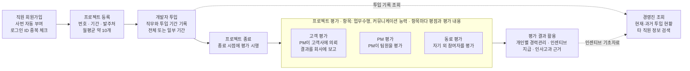

# SI-PMS 프로젝트 분석 보고서 (요구사항 정의서)

> 1차 산출물 · 2026-10-26 (월) 23:59 LMS 제출 · 배점 10%
> **제출본은 엑셀 양식 [`01-1_요구사항정의서.xlsx`](01-1_요구사항정의서.xlsx) 입니다.** 이 문서는 같은 내용을 설명하는 보조 자료(흐름도·추적표 포함)이며, 요구사항 ID 는 엑셀의 URQ 번호가 기준입니다.
> 설계 단계(11/09)에서 가정과 비즈니스 규칙을 더한 확장판은 [`01_요구사항정의서.md`](01_요구사항정의서.md) 입니다.

## 보고서 정보

이 보고서는 과제의 1차 산출물(프로젝트 분석 보고, 배점 10%)이며, 과제 지침에 따라 **Problem Description 에 적힌 내용만** 요구사항으로 정의합니다. 원문에 없는 규칙이나 가정은 넣지 않고, 원문만으로 결정할 수 없는 점은 마지막 절에 질문으로 따로 모았습니다.

| 항목 | 내용 |
| --- | --- |
| 과목 | Database Design (Fall 2026) |
| 과제 | Database Design Team Project |
| 시스템명 | SI-PMS (SI 프로젝트 인력·평가 관리 시스템) |
| 조 / 팀원 | (조 번호, 팀원 이름·학번 기입) |
| 제출일 | 2026-10-26 (월) 23:59, LMS |
| 산출물 | 요구사항 정의서 (Problem Description only) |

## 시스템 개요와 목적

SI-PMS 는 SI 업체가 **프로젝트에 누가, 어떤 직무로, 언제부터 언제까지 투입되었는지** 와 **프로젝트 종료 평가 결과** 를 한 곳에서 관리하는 사내 업무용 웹 시스템입니다.

| 구분 | 내용 |
| --- | --- |
| 회사 | 직원 100명 규모의 SI 업체 |
| 인력 구성 | 개발자 70명, 마케팅·경영관리·연구개발 직원 30명 |
| 업무량 | 개발자 70명이 월평균 약 10개 프로젝트를 수행 |
| 투입 형태 | 프로젝트 초기부터 종료까지 투입되거나, 일정 기간만 투입 |
| 직무 | 경력과 기술 등급에 따라 PM, PL, 분석자, 설계자, 프로그래머, 테스터 |

시스템의 목적은 세 가지입니다.

1. 직원이 자기 정보(경력, 기술 포함)를 직접 등록하고 고칠 수 있게 한다.
2. 경영진이 현재와 과거의 프로젝트 투입 현황을 체계적으로 파악하게 한다.
3. 프로젝트 종료 평가를 기록해 개인별 경력관리, 인센티브 지급, 인사고과의 근거 자료로 쓴다.

## 업무 현황 분석

현행 업무는 직원 등록, 프로젝트 등록, 개발자 투입, 프로젝트 종료 평가, 평가 결과 활용의 순서로 흐릅니다. 경영진은 이 흐름에서 쌓인 투입 기록과 평가 결과를 조회합니다.

투입 기록은 프로젝트가 끝난 뒤에도 지우지 않아야 과거 특정 시점의 참여 현황과 개인 경력을 다시 볼 수 있습니다. 세 가지 평가는 평가자가 각각 다르므로(고객사 담당자, PM, 동료) 어느 평가인지와 누가 평가했는지를 함께 기록해야 합니다.

## 사용자와 권한

시스템 사용자는 네 부류이며, 경영진만 다른 직원의 정보를 검색할 수 있습니다.

| 사용자 | 설명 | 할 수 있는 일 | 근거 문장 |
| --- | --- | --- | --- |
| 일반직원 | 개발자와 마케팅·경영관리·연구개발 직원 | 회원가입, 본인 정보 저장·수정·변경 | "직원은 회원가입 페이지를 통해 자신의 정보를 … 수정/변경" |
| 프로젝트 참여자 | 프로젝트에 투입된 개발자 | 프로젝트 종료 시 자기 외 참여자를 동료 평가 | "각 멤버들이 자기 이외의 프로젝트 참여자에 대해서 평가" |
| PM | 프로젝트에서 PM 직무를 맡은 개발자 | 팀원 PM 평가, 고객 평가 의뢰와 회사 보고 | "PM이 주관하여 … 평가서를 의뢰하고 결과를 회사에 보고" |
| 경영진 | 회사 경영진 | 타 직원 정보 검색, 프로젝트·투입 현황과 이력 조회 | "경영진은 … 타 직원들의 정보를 검색할 수 있는 권한" |
| 고객사 담당자 | 발주처의 담당자 (외부) | 프로젝트 참여 직원에 대한 고객 평가 작성 | "고객사의 담당자로부터 평가서를 의뢰" |

일반직원과 경영진의 구분은 권한의 차이이고, PM 과 참여자는 프로젝트별로 정해지는 역할입니다. 같은 개발자가 한 프로젝트에서는 PM, 다른 프로젝트에서는 참여자가 될 수 있습니다.

## 기능 요구사항

기능 요구사항은 일곱 영역 18개입니다. 모두 Problem Description 의 문장에서 나왔고, 출처 문단은 ¶1~¶5 로 표시했습니다.

| ID | 영역 | 요구사항 | 출처 |
| --- | --- | --- | --- |
| FR-01 | 회원가입 | 직원은 회원가입 페이지에서 자신의 정보를 입력해 데이터베이스에 저장한다. | ¶2 |
| FR-02 | 회원가입 | 회원가입 시 로그인 ID 중복 체크 기능을 제공한다. | ¶2 |
| FR-03 | 회원가입 | 이미 등록된 ID 로 가입을 신청하면 에러 메시지를 출력하고, 중복되지 않는 새 ID 를 다시 입력할 수 있게 한다. | ¶2 |
| FR-04 | 회원가입 | 직원 사번은 정해진 규칙에 따라 시스템이 자동으로 부여한다. | ¶2 |
| FR-05 | 직원 정보 | 직원은 저장된 자신의 정보를 수정·변경할 수 있다. | ¶2 |
| FR-06 | 직원 정보 | 직원의 직원번호, 직원명, 주민등록번호, 최종학력을 관리한다. | ¶2 |
| FR-07 | 직원 정보 | 프로젝트 투입 직원에 대해서는 경력과 경험한 기술(Skill Set)을 추가로 관리한다. | ¶2 |
| FR-08 | 프로젝트 | 프로젝트의 프로젝트번호, 프로젝트명, 착수일자, 종료일자, 발주처를 관리한다. | ¶2 |
| FR-09 | 투입 | 개발자의 프로젝트 투입을 기록한다. 투입은 프로젝트 초기부터 종료까지일 수도, 일정 기간만일 수도 있다. | ¶1 |
| FR-10 | 투입 | 투입된 개발자가 맡은 직무(PM, PL, 분석자, 설계자, 프로그래머, 테스터)와 투입 기간을 기록한다. | ¶1, ¶3 |
| FR-11 | 경영진 조회 | 현재 수행 중인 프로젝트 수를 조회한다. | ¶3 |
| FR-12 | 경영진 조회 | 프로젝트별로 현재 투입된 직원 수, 각 직원의 직무와 투입 기간을 조회한다. | ¶3 |
| FR-13 | 경영진 조회 | 과거 특정 시점에 어떤 직원이 어느 프로젝트에 어떤 직무로 참여했는지 조회한다. | ¶3 |
| FR-14 | 경영진 조회 | 개인별 경력(프로젝트 참여 이력)과 인센티브 지급을 위한 기초자료를 추출한다. | ¶3 |
| FR-15 | 권한 | 경영진은 일반직원과 달리 다른 직원의 정보를 검색할 수 있다. | ¶3 |
| FR-16 | 평가 | 프로젝트 종료 시점에 참여 직원에 대해 고객 평가, PM 평가, 동료 평가를 기록한다. 각 평가에는 평가자와 피평가자가 있다. | ¶4 |
| FR-17 | 평가 | 평가 항목은 업무수행 평가와 커뮤니케이션 능력 평가이며, 항목마다 평점과 평가 내용을 기록한다. | ¶4 |
| FR-18 | 평가 | 고객 평가는 PM 이 고객사 담당자에게 의뢰하고 결과를 회사에 보고하며, 동료 평가는 자기 이외의 참여자를, PM 평가는 PM 이 팀원을 평가한다. | ¶4, ¶5 |

## 데이터 요구사항

Problem Description 이 관리하라고 명시한 정보는 아홉 가지입니다. 아래 속성은 원문에 나온 것만 적었고, 추가 속성은 설계 단계(11/09)에서 정합니다.

| 관리 대상 | 원문에 나온 속성 | 비고 |
| --- | --- | --- |
| 직원 | 직원번호(사번), 직원명, 주민등록번호, 최종학력 | 사번은 규칙에 따라 자동 부여. 개발자와 마케팅·경영관리·연구개발 직원으로 나뉨 |
| 로그인 정보 | 로그인 ID | 중복되면 안 됨 |
| 경력 | 프로젝트 투입 직원의 경력 | 직무를 정하는 기준 중 하나 |
| 기술(Skill Set) | 프로젝트 투입 직원이 경험한 기술 | 한 직원이 여러 기술을 가짐 |
| 기술 등급 | 개발자의 기술 등급 | 직무를 정하는 기준 중 하나. 등급 체계는 원문에 없음 |
| 프로젝트 | 프로젝트번호, 프로젝트명, 착수일자, 종료일자, 발주처 | 월평균 약 10개 수행 |
| 발주처 | 프로젝트를 발주한 고객사, 고객사의 담당자 | 담당자가 고객 평가를 작성 |
| 투입 | 투입 직원, 프로젝트, 직무, 투입 기간 | 과거 시점 조회를 위해 이력을 보존해야 함 |
| 평가 | 평가 종류(고객·PM·동료), 평가자, 피평가자, 평가 항목별 평점과 평가 내용 | 평가 항목은 업무수행, 커뮤니케이션 능력 |

직무는 PM, PL, 분석자, 설계자, 프로그래머, 테스터 여섯 가지로 원문에 정해져 있습니다.

## 비기능 요구사항

10/26 산출물은 과제 일정표의 '요구사항 정의서 ("Problem Description" only!)' 에 따라 Problem Description 에서 나온 것만 적었습니다. 과제 2절 Requirements(웹 기반, 관계형 DBMS, IE 표기법, 데이터 적재)와 5절 핵심 가이드라인은 설계(11/09) 이후 산출물에서 다룹니다.

| ID | 요구사항 | 출처 |
| --- | --- | --- |
| NFR-04 | 일반직원은 본인 정보만, 경영진은 타 직원 정보까지 조회하도록 권한을 나눈다. | ¶2, ¶3 |

규모는 직원 약 100명과 월 10개 프로젝트로, 대용량 처리보다 투입 이력이 계속 쌓이는 점이 성능의 핵심입니다.

## 요구사항 추적표

Problem Description 의 모든 문장이 하나 이상의 요구사항에 대응됩니다. 문단 번호는 ¶1 회사와 투입, ¶2 관리 정보와 회원가입, ¶3 경영진 조회, ¶4 평가 개요, ¶5 평가 종류별 설명입니다.

| 문단 | 원문 요지 | 요구사항 |
| --- | --- | --- |
| ¶1 | 개발자 70명이 월평균 10개 프로젝트 수행 | FR-09, 데이터(프로젝트) |
| ¶1 | 초기부터 종료까지 또는 일정 기간만 투입 | FR-09 |
| ¶1 | 경력과 기술 등급에 따라 PM·PL·분석자·설계자·프로그래머·테스터 | FR-10, 데이터(경력, 기술 등급) |
| ¶2 | 프로젝트번호·명·착수/종료일자·발주처 관리 | FR-08 |
| ¶2 | 직원번호·직원명·주민등록번호·최종학력 관리 | FR-06 |
| ¶2 | 투입 직원의 경력과 경험한 기술(Skill Set) 관리 | FR-07 |
| ¶2 | 회원가입 페이지에서 정보 저장·수정/변경 | FR-01, FR-05 |
| ¶2 | 사번 자동 부여 | FR-04 |
| ¶2 | 로그인 ID 중복 체크, 에러 메시지 후 새 ID 입력 | FR-02, FR-03 |
| ¶3 | 수행 중인 프로젝트 수, 프로젝트별 투입 인원·직무·기간 | FR-11, FR-12 |
| ¶3 | 과거 특정 시점의 참여 이력 | FR-13 |
| ¶3 | 개인별 경력관리, 인센티브 기초자료 | FR-14 |
| ¶3 | 경영진은 타 직원 정보 검색 권한 | FR-15, NFR-04 |
| ¶4 | 종료 시점 평가: 고객·PM·동료, 평가자와 피평가자 | FR-16 |
| ¶4 | 항목(업무수행, 커뮤니케이션)별 평점과 평가 내용 | FR-17 |
| ¶5 | 고객 평가는 PM 주관으로 의뢰하고 회사에 보고 | FR-18 |
| ¶5 | 동료 평가는 자기 이외의 참여자, PM 평가는 PM 이 팀원을 | FR-18 |
| ¶5 | 평가 결과는 인사고과·인사 평가의 근거 자료 | FR-14, FR-16 |

## 확인이 필요한 사항

Problem Description 만으로는 정할 수 없는 점 12가지를 모았습니다. 답은 설계 보고(11/09)에서 가정으로 정해 설계에 반영합니다. 제출본 엑셀의 '팀 확인 필요 사항' 시트에는 이 질문을 20개로 나눠 결정 내용까지 적었습니다.

| # | 질문 | 관련 요구사항 |
| --- | --- | --- |
| Q-01 | 사번을 만드는 "정해진 규칙"은 무엇인가? (예: 입사연도 + 일련번호) | FR-04 |
| Q-02 | 프로젝트번호도 자동으로 만드는가, 직접 입력하는가? | FR-08 |
| Q-03 | 기술 등급은 몇 단계이며, 누가 어떤 기준으로 정하고 바꾸는가? | FR-07, FR-10 |
| Q-04 | 경력과 기술 등급에 따라 맡을 수 있는 직무가 어떻게 제한되는가? (예: PM 은 어느 등급 이상) | FR-10 |
| Q-05 | 한 직원이 같은 기간에 여러 프로젝트에 투입될 수 있는가? 있다면 투입 비율을 관리하는가? | FR-09 |
| Q-06 | 한 프로젝트의 PM 은 한 명인가? 프로젝트 중간에 바뀔 수 있는가? | FR-10, FR-18 |
| Q-07 | 마케팅·경영관리·연구개발 직원도 프로젝트에 투입될 수 있는가? | FR-09 |
| Q-08 | 경영진은 어떻게 구분하는가? (부서, 직책, 별도 권한 부여) 경영진이 타 직원 정보를 수정할 수도 있는가? | FR-15 |
| Q-09 | 발주처에서 관리할 정보는 무엇인가? 한 발주처에 담당자가 여러 명일 수 있는가? | FR-08, FR-18 |
| Q-10 | 고객사 담당자는 시스템에 직접 입력하는가, PM 이 대신 입력하는가? | FR-18 |
| Q-11 | 평점의 범위는 무엇인가? (예: 1~5점) 평가 항목이 나중에 늘어날 수 있는가? | FR-17 |
| Q-12 | 인센티브 기초자료는 어떤 형태인가? 고객·PM·동료 평가를 어떻게 합산하는가? | FR-14 |
