# E-R Diagram (Information Engineering 표기법)

> 2차 산출물(설계 보고). 아래 Mermaid 다이어그램은 IE(까마귀발) 표기법으로 렌더링된다 (GitHub / VS Code 미리보기).
> 보고서용 고해상도 이미지는 `docs/erd.dbml` 을 [dbdiagram.io](https://dbdiagram.io) 에 붙여 넣어 IE 표기로 내보내면 된다.
>
> 표기 규칙: `||` 정확히 1 (필수) · `o|` 0 또는 1 · `o{` 0 이상 (선택) · `|{` 1 이상 (필수)
> **모든 1:N 관계의 1측은 `o{` (Partial)** 로 설계하여 Total:Total 참여를 두지 않았다 (§3).

## 1. 전체 ERD

```mermaid
erDiagram
    %% ---------- 발주처 ----------
    CLIENT ||--o{ CLIENT_CONTACT : "담당자를 둔다"
    CLIENT ||--o{ PROJECT : "발주한다"

    %% ---------- 직원 (슈퍼타입-서브타입, 배타적·전체) ----------
    EMPLOYEE ||--o| DEVELOPER : "is-a (emp_type=DEV)"
    EMPLOYEE ||--o| STAFF : "is-a (emp_type=STAFF)"
    EMPLOYEE ||--o| USER_ACCOUNT : "로그인 계정"

    %% ---------- 기술 (M:N 해소) ----------
    DEVELOPER ||--o{ EMPLOYEE_SKILL : "보유"
    SKILL ||--o{ EMPLOYEE_SKILL : ""
    PROJECT ||--o{ PROJECT_SKILL : "요구"
    SKILL ||--o{ PROJECT_SKILL : ""

    %% ---------- 투입 (개발자:프로젝트 M:N 해소, 이력) ----------
    PROJECT ||--o{ ASSIGNMENT : "인력 투입"
    DEVELOPER ||--o{ ASSIGNMENT : "투입된다"
    JOB_ROLE ||--o{ ASSIGNMENT : "직무"

    %% ---------- 평가 (슈퍼타입-서브타입, 배타적·전체) ----------
    PROJECT ||--o{ EVALUATION : "종료 시 평가"
    DEVELOPER ||--o{ EVALUATION : "피평가자"
    EVALUATION ||--o| CUSTOMER_EVAL : "is-a (CUSTOMER)"
    EVALUATION ||--o| PM_EVAL : "is-a (PM)"
    EVALUATION ||--o| PEER_EVAL : "is-a (PEER)"
    CLIENT_CONTACT ||--o{ CUSTOMER_EVAL : "평가자"
    DEVELOPER ||--o{ CUSTOMER_EVAL : "의뢰 PM"
    DEVELOPER ||--o{ PM_EVAL : "평가자(PM)"
    DEVELOPER ||--o{ PEER_EVAL : "평가자(동료)"
    EVALUATION ||--o{ EVAL_DETAIL : "항목별 평점"
    EVAL_ITEM ||--o{ EVAL_DETAIL : ""

    %% ---------- 이력 ----------
    DEVELOPER ||--o{ GRADE_HISTORY : "등급 변경"
    EMPLOYEE ||--o{ GRADE_HISTORY : "처리자"

    CLIENT {
        int client_id PK
        varchar client_name
        char business_reg_no UK
        varchar industry
        varchar address
        varchar phone
    }
    CLIENT_CONTACT {
        int contact_id PK
        int client_id FK
        varchar contact_name
        varchar position
        varchar email
        varchar phone
        tinyint is_active
    }
    EMPLOYEE {
        int emp_id PK
        char emp_no UK "E+YY+NNNN 자동채번"
        varchar emp_name
        char resident_reg_no UK
        enum education_level
        date hire_date
        enum emp_type "DEV | STAFF (판별자)"
        varchar email
        varchar phone
        enum status
    }
    DEVELOPER {
        int emp_id PK, FK
        enum skill_grade "초급|중급|고급|특급"
        date career_start_date
        date grade_updated_at
    }
    STAFF {
        int emp_id PK, FK
        enum department "MARKETING|MANAGEMENT|RND"
        varchar job_title
    }
    USER_ACCOUNT {
        int emp_id PK, FK
        varchar login_id UK
        varchar password_hash
        enum auth_role "EMPLOYEE | EXECUTIVE"
        tinyint is_active
        datetime last_login_at
    }
    SKILL {
        int skill_id PK
        varchar skill_name UK
        enum category
    }
    EMPLOYEE_SKILL {
        int emp_id PK, FK
        int skill_id PK, FK
        tinyint proficiency "1~5"
        decimal years_used
        date last_used_date
    }
    PROJECT {
        int project_id PK
        varchar project_code UK "P+YYYY-NNN 자동채번"
        varchar project_name
        int client_id FK
        date start_date
        date end_date
        enum status
        decimal contract_amount
        varchar description
    }
    PROJECT_SKILL {
        int project_id PK, FK
        int skill_id PK, FK
        tinyint required_level
    }
    JOB_ROLE {
        int role_id PK
        varchar role_code UK
        varchar role_name
        enum min_grade "투입 최소 등급"
        tinyint sort_order
    }
    ASSIGNMENT {
        int assignment_id PK
        int project_id FK
        int emp_id FK
        int role_id FK
        date start_date
        date end_date
        tinyint participation_rate "10~100 %"
        varchar note
    }
    EVALUATION {
        int eval_id PK
        int project_id FK
        int evaluatee_emp_id FK
        enum eval_type "CUSTOMER|PM|PEER (판별자)"
        enum status "REQUESTED|SUBMITTED|REPORTED"
        date eval_date
        varchar overall_comment
    }
    CUSTOMER_EVAL {
        int eval_id PK, FK
        int contact_id FK
        int requested_by_emp_id FK
        datetime requested_at
        char access_token UK
        datetime reported_at
    }
    PM_EVAL {
        int eval_id PK, FK
        int evaluator_emp_id FK
        tinyint recommend_incentive
    }
    PEER_EVAL {
        int eval_id PK, FK
        int evaluator_emp_id FK
        tinyint is_anonymous
    }
    EVAL_ITEM {
        int item_id PK
        varchar item_code UK "WORK | COMM"
        varchar item_name
        varchar description
        decimal weight
        tinyint is_active
    }
    EVAL_DETAIL {
        int eval_id PK, FK
        int item_id PK, FK
        tinyint score "1~5"
        varchar comment
    }
    GRADE_HISTORY {
        int history_id PK
        int emp_id FK
        enum old_grade
        enum new_grade
        datetime changed_at
        int changed_by_emp_id FK
        varchar reason
    }
```

정책/시스템 테이블(관계선 없음): `EVAL_TYPE_WEIGHT`(평가 유형별 가중치), `SEQ_COUNTER`(채번 카운터).

## 2. 핵심 가이드라인 반영 요약

| 가이드라인 | 반영 |
|---|---|
| "프로젝트 평가"와 "직원"은 슈퍼타입-서브타입 | **EMPLOYEE** → DEVELOPER / STAFF (판별자 `emp_type`, 배타적·전체 참여). **EVALUATION** → CUSTOMER_EVAL / PM_EVAL / PEER_EVAL (판별자 `eval_type`, 배타적·전체 참여). 서브타입 PK = 슈퍼타입 PK (1:1, ON DELETE CASCADE). 서브타입-판별자 불일치는 트리거(BR-10)로 차단 |
| "발주처"는 별도 엔티티 | **CLIENT** (사업자등록번호 UK) + **CLIENT_CONTACT** 1:N. 고객 평가의 평가자는 CLIENT_CONTACT 를 참조하여 "고객이 평가한다" 를 데이터 모델로 표현 |
| M:N 관계 지양 | 개발자–기술 → **EMPLOYEE_SKILL**, 프로젝트–기술 → **PROJECT_SKILL**, 개발자–프로젝트 → **ASSIGNMENT** (직무·기간·투입률을 가진 교차 엔티티로 승격) |
| 1:N 에서 Total:Total 지양 | 모든 1:N 의 1측을 Partial 로 설계 (§3) |

## 3. 관계별 참여 제약 (Total:Total 회피 근거)

| 관계 (1 : N) | 1측 참여 | N측 참여 | 1측이 Partial 인 업무적 이유 |
|---|---|---|---|
| CLIENT : CLIENT_CONTACT | Partial | Total | 담당자가 아직 등록되지 않은 신규 발주처 존재 |
| CLIENT : PROJECT | Partial | Total | 영업 단계(수주 전) 발주처는 프로젝트가 없음 |
| EMPLOYEE : USER_ACCOUNT (1:1) | Partial | Total | 데이터 import 로 등록된 직원은 계정 생성 전일 수 있음 |
| DEVELOPER : EMPLOYEE_SKILL | Partial | Total | 신규 개발자는 기술 미등록 |
| SKILL : EMPLOYEE_SKILL / PROJECT_SKILL | Partial | Total | 사전에 등록되었으나 아직 쓰이지 않은 기술 |
| PROJECT : ASSIGNMENT | Partial | Total | **예정(PLANNED) 프로젝트는 투입 전** |
| DEVELOPER : ASSIGNMENT | Partial | Total | 대기(벤치) 개발자, 신규 입사자 |
| JOB_ROLE : ASSIGNMENT | Partial | Total | 사용되지 않는 직무 코드 허용 |
| PROJECT : EVALUATION | Partial | Total | 진행 중/취소 프로젝트는 평가 없음 |
| DEVELOPER : EVALUATION (피평가자) | Partial | Total | 아직 종료 프로젝트가 없는 개발자 |
| EVALUATION : EVAL_DETAIL | **Partial** | Total | **의뢰됨(REQUESTED) 상태의 고객 평가는 상세 점수가 없음** — 평가 워크플로우 상태가 Partial 참여를 자연스럽게 만든다 |
| EVAL_ITEM : EVAL_DETAIL | Partial | Total | 신설 항목은 아직 평가 없음 |
| CLIENT_CONTACT : CUSTOMER_EVAL | Partial | Total | 평가에 참여하지 않은 담당자 |
| DEVELOPER : PM_EVAL / PEER_EVAL / CUSTOMER_EVAL(의뢰) | Partial | Total | 평가자 역할을 하지 않은 개발자 |
| DEVELOPER : GRADE_HISTORY | Partial | Total | 등급 변경이 없는 개발자 |

슈퍼타입-서브타입(EMPLOYEE→DEVELOPER/STAFF, EVALUATION→3 서브타입)은 1:1 이며 "전체·배타" 참여가 설계 의도이다(모든 직원은 개발자 또는 지원직 중 하나).

## 4. 식별자 설계

| 엔티티 | 주키 | 대체키(UK) | 비고 |
|---|---|---|---|
| EMPLOYEE | emp_id (대리키) | emp_no(사번), resident_reg_no | 사번은 규칙 채번(변경 가능성)이므로 대리키를 PK 로 |
| PROJECT | project_id | project_code | 동일 |
| ASSIGNMENT | assignment_id | — | 동일 직원이 같은 프로젝트에 기간을 달리하여 여러 번 투입 가능 → (project, emp) 복합키 부적합 |
| EVALUATION | eval_id | — | 서브타입이 PK 를 공유 |
| EMPLOYEE_SKILL / PROJECT_SKILL / EVAL_DETAIL | 복합키 | — | 순수 교차 엔티티 |
